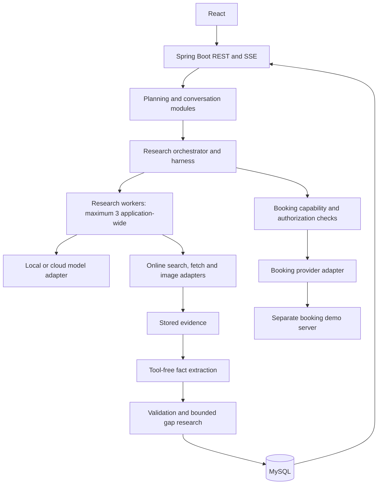

# TripPilot — Project Document

## Purpose and scope

TripPilot is an India-focused college MVP for active online travel research and planning. Users describe travel intent, departure location, dates, budget and currency, travelers, preferences, and special requirements. The system researches options, supports comparisons and follow-up questions, and preserves independent contexts for selected trips.

The primary model deployment is local. Cloud integration uses the same adapter contract. Internet connectivity remains necessary for fresh research even when inference is local. Bookings normally remain external links. An optional demonstration enables booking tools against a separate provider server.

## Architecture

React communicates with a Spring Boot modular monolith through REST APIs and Server-Sent Events for research progress. MySQL stores users, requests, trip contexts, conversations, evidence, findings, jobs, and diagnostic events. Search, page retrieval, images, and local/cloud inference use replaceable adapters. A separate booking demo server exposes a provider-style API.

Backend modules: identity, planning, conversations, research, model integration, retrieval, validation, presentation, booking integration, and observability. Modules remain in one application with explicit ownership and interfaces.

## Research workflow

1. Interpret the request into structured requirements; ask for essential missing input.
2. Persist a research job and its requirement revision, selected model, and harness configuration.
3. Queue independent research tasks under an application-wide three-worker limit.
4. Search online, fetch permitted pages, extract content, and persist source snapshots and passages.
5. Extract candidate facts referencing backend-issued evidence identifiers.
6. Validate structure, evidence existence, applicability, support, freshness, conflicts, and completeness.
7. Perform targeted gap searches within fixed budgets, then publish supported findings and explicit gaps.
8. On selection, create an independent trip context and perform deeper research using relevant evidence plus fresh searches.

The worker limit is distinct from inference concurrency. Local inference may be serialized according to available hardware. Each new job snapshots the selected model; settings changes do not alter running jobs.

## Evidence and validation contract

Validation establishes traceable support, not universal factual truth. A citation must reference a fetched passage and support the particular claim. An advertised starting price does not establish a date-specific quote, room configuration, taxes, or availability. Search snippets may guide retrieval but do not replace fetched evidence for consequential details.

Fields use `SUPPORTED`, `ESTIMATED`, `CONFLICTING`, `UNAVAILABLE`, or `STALE` states. Each stores a value where applicable, evidence references, scope, timestamps, and a reason or assumptions. A required field must be accounted for; it need not contain a value. Estimates must record supported inputs and deterministic calculations. Conflict handling preserves competing claims rather than silently selecting one.

Deterministic checks handle schema, identifiers, exact values, dates, currency, and known scope. Semantic verification can assist with policy interpretation but remains fallible. Ambiguous support is not published as an established fact. Model confidence is not evidence. Results include source links, retrieval timestamps, limitations, and guidance to verify important information with providers.

## Local model harness

The backend owns the state machine, allowed tools, argument validation, job transitions, persistence, concurrency, authorization, and resource budgets. The model proposes bounded actions. No arbitrary shell, SQL, or unrestricted HTTP execution is available. Extraction invocations receive untrusted page content without action tools. Page instructions cannot grant permissions.

Enforce limits for model turns, searches, pages, retries, time, and input size. Validate fetch destinations, redirects, and response types; the general web fetcher cannot access private infrastructure. Provider adapters have separately configured destinations. Malformed output gets bounded repair attempts. Exhausted searches produce partial results. Final factual cards render from validated records; suggestions remain distinguishable from retrieved facts.

## Persistence and observability

Core records: users and preferences; planning sessions; request revisions; trip options and selections; conversations and messages; research jobs and tasks; sources and evidence chunks; facts and fact-source associations; images and attribution; trace events; booking intents and operations.

Research context is separate from chat history. New requests prioritize active search. Saved evidence supports follow-ups, avoids redundant work, and enables diagnosis. Volatile details are refreshed according to explicit field policies. Research revisions preserve previous findings. MySQL supports scoped/full-text evidence retrieval initially; embeddings and a vector store are deferred until justified.

Every run has a trace ID. Persist model/configuration and prompt/harness versions, model-visible inputs and outputs, proposed/accepted/rejected tool calls, evidence, validation outcomes, retries, errors, timings, and available usage metrics. Redact credentials and sensitive traveler details from diagnostics. Hidden model reasoning is not assumed available. A Research Inspector displays task → tool → evidence → candidate → validation → result. Persist jobs before execution and handle interrupted jobs explicitly after restart.

## Optional booking demonstration

Research-only mode exposes research tools and booking links. Booking-enabled mode additionally exposes quote, hold, submit, and status tools through a provider-neutral interface. The backend enforces the toggle and rechecks it before actions. Enabling tools alone does not authorize a booking; a user instruction defines the permitted trip, travelers, dates, and cost ceiling.

The separate demo server implements inventory search, quotes and conditions, expiring holds, booking submission, and status lookup. The agent uses ordinary contracts without demo-specific reasoning; deployment configuration and UI identify the demo environment. Use quote/hold identifiers, backend checks on price and traveler scope, idempotency keys, and reconciliation after uncertain responses. Only provider confirmation establishes success. Test price changes, sold-out inventory, hold expiry, duplicate requests, and timeouts. Real payments and commercial provider integrations are outside this MVP.

## Delivery phases

| Phase | Scope | Completion evidence |
|---|---|---|
| 1. Foundations and contracts | Workspace, runtime choices, database migrations, identity, API/data/tool contracts, harness policies | Services start; migration and access checks pass; contracts documented |
| 2. Active research and evidence | Local model adapter, online search/fetch, evidence storage, durable jobs, three-worker queue, SSE | A real search is fetched, saved, traced and streamed; limits and interruption behavior verified |
| 3. Validation harness | Structured extraction, evidence checks, field states, bounded retries, safe result assembly | Missing/conflicting/malicious evidence cannot fabricate accepted fields; budgets terminate |
| 4. Planning experience | React request flow, comparisons, selections, independent context, deep research, follow-ups, images | End-to-end India trip planning with fresh research and isolated selected contexts |
| 5. Booking demonstration | Separate provider server, capability toggle, authorization, quotes/holds/bookings, idempotency | Authorized flow succeeds; disabled/unauthorized actions fail; timeout reconciliation prevents duplicates |
| 6. Diagnostics and delivery | Research Inspector, failure evaluation, documentation, deployment/demo preparation | Inspectable traces, completed evaluation report, reproducible setup and demonstration |

Tracing starts in Phase 2; Phase 6 adds the complete inspection experience. Phases 1–5 are complete. Current acceptance passes 80 backend and 7 provider tests with zero failures/errors/skips plus live research, production planning/booking browser checks and packaged services. Booking is an optional local simulation with typed user consent and deterministic backend continuation, independent of model/extraction output. See [booking contracts/policy/verification](docs/phase5-booking.md) and [planning](docs/phase4-planning.md).

## Implemented baseline — 2026-10-11

Phases 1–5 are complete. Java 21, Maven 3.9.16 wrapper, Spring Boot 4.1.1, React 19.2, TypeScript 5.9, Vite 7 and MySQL 8.4 are verified. Both Java services build and start on Java 21. Eighty backend and seven provider tests pass without failures/errors/skips with real MySQL, online retrieval, pinned local inference/extraction, validation, worker/SSE and booking failure/reconciliation behavior; frontend production build, desktop/mobile browser and HTTP smoke checks pass. Development uses direct portable MySQL 8.4.11 on port 13306 without Docker, preserving the existing MySQL80 service. Backend/frontend proxy default to localhost:8002; SERVER_PORT and BACKEND_URL can override these defaults.

Implemented: local registration with hashed passwords, CSRF-protected login/logout, durable JDBC sessions, owner-scoped planning sessions, ownership foreign keys, typed requirement/model/tool/evidence/field contracts, numeric policies and redacted interruption recovery. Phase 2 adds immutable revisions/jobs, idempotent admission, safe online search/fetch, evidence, three workers, single-slot inference, cancellation/recovery and scoped diagnostics/SSE through V4. Phase 3 adds extraction/support/scope/freshness validation, conservative alternatives, explicit gaps, deterministic date estimates and scoped results through V5. Phase 4 adds authenticated React clarification/cards/comparison, independent selected contexts/history/fresh research and attributed images through V6. Semantic truth remains unverified; conflicts remain visible. Phase 5 adds V7 immutable scoped quotes and authorization attempts, an ordinary provider adapter, feature/consent/ceiling/expiry/revision gates, stable submission keys, durable uncertainty/reconciliation and a selected-trip booking panel. The separate local provider implements inventory/quote/hold/submit/status with an exclusively locked, flushed/atomically replaced ledger. Only provider confirmation establishes success; one confirmed/unresolved stay per context prevents duplicate authorizations. Current commercial inventory, payment, cancellation/refunds and multi-provider aggregate bookings remain outside scope.

Hardware: RTX 4060 Laptop GPU with 8188 MiB VRAM and 25,463,480,320 bytes RAM. The selected installed Ollama 0.20.4 E4B Q4_K_M artifact has approximately 8B total parameters and is 9.6 GB on disk. Forty repeated held-out short cases and twenty larger-context cases passed with one bounded structural repair; the artifact is accepted for constrained development with strict validation, selected evidence and serialized inference. It retains substantial CPU weights; training lineage is identified by the local library tag and was not independently attested. Phase 2 is complete with a provider-neutral model adapter, immutable job snapshots, safe Wikivoyage travel-guide retrieval, durable workers and owner-scoped REST/SSE. See docs/phase2-research.md. See [local model evaluation](docs/local-model-evaluation.md).

See [foundation contracts](docs/foundation-contracts.md) and [setup instructions](README.md) for implemented endpoints, initial budgets/freshness policies, verification and remaining boundaries.

## Open implementation choices

Destination-only guide research does not require dates, travelers or a budget. The dedicated application model must remain available; the UI distinguishes runtime/extraction failures from legitimate evidence gaps. Article text is selected before navigation, guide-name letter case does not change scope, and exact quotes still require validated source passages. Startup and refresh troubleshooting are documented in README. Live prices/inventory/policies remain unavailable from guides.

Guide research selects saved sentences for description, stay guidance, transport and activities and uses focused calls within the original harness limits. New jobs use a three-key quote proposal; the backend binds captured travel scope before validation. Complete source sentences can use an established destination article as context, with semantic suitability still requiring review. This is general guide information rather than verified dated hotel/ticket inventory or a complete itinerary.

Phase 2 is complete. Initial search coverage is Wikivoyage travel guides, not whole-web search or live inventory/quotes. Phase 3 extractive validation and bounded repair/retry are complete with real local-model/adversarial acceptance and explicit gaps. See [validation/results](docs/phase3-validation.md). Optional Commons image attribution and interactive planning are implemented in Phase 4; unavailable imagery stays explicit. Provider-specific freshness adjustments, source retention and broader model robustness evaluation remain later work. No real booking/payment integration is authorized.

